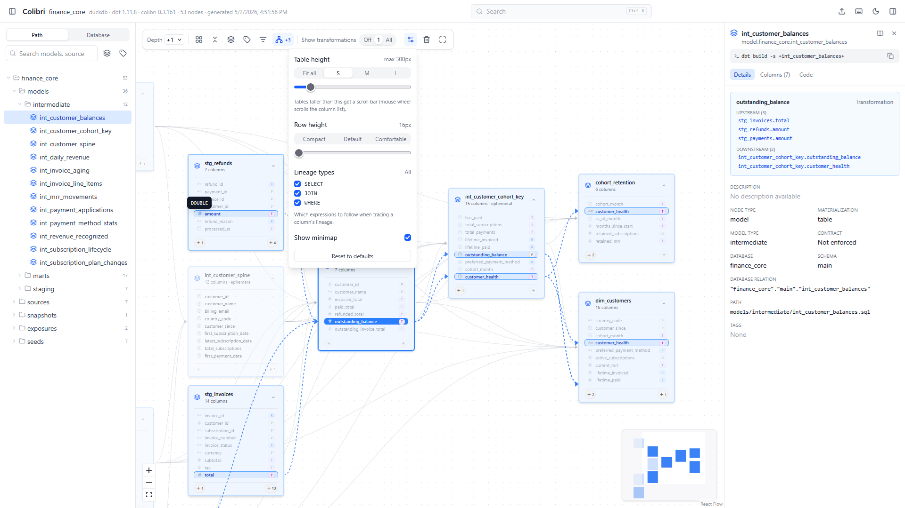
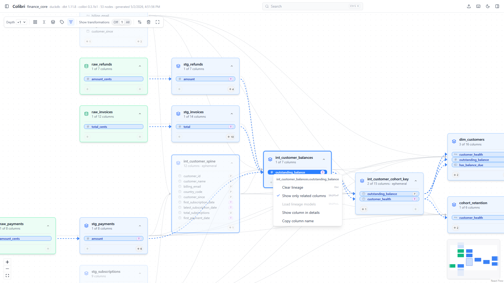
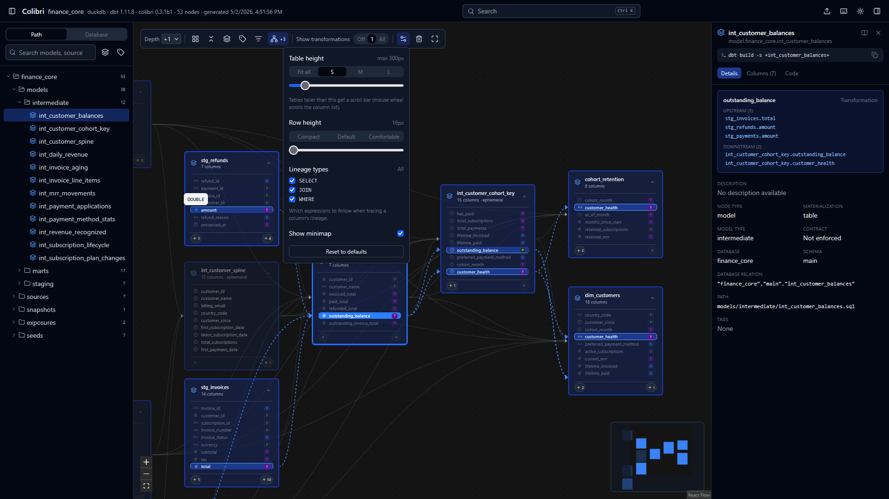

# sql-analyzer-web

An enhanced web interface for [dbt-colibri](https://github.com/b-ned/dbt-colibri), the column-level lineage tool for dbt projects.

## About

- This project improves the web interface of [dbt-colibri](https://github.com/b-ned/dbt-colibri).
- It reads the JSON lineage file (`colibri-manifest.json`) that [dbt-colibri](https://github.com/b-ned/dbt-colibri) produces, so you still generate your lineage data with dbt-colibri itself.

## Features

### Display improvements over dbt-colibri

| dbt-colibri limitation | Improvement in this project |
| --- | --- |
| Too much space goes to padding, so few columns fit on screen. | Choose row spacing and table height with presets or a slider. |
| Tables are either collapsed to the table name or capped at a fixed height. Overflowing columns can only be scrolled by dragging the scrollbar (the mouse wheel doesn't work), and tracing lineage between two distant columns means scrolling. | Option to expand tables fully and show every column. |
| Data type icons show only the basic type (text, number, time), without details such as the length of a text type. | Tooltips on data type icons show the full type. |
| Clicking a table opens the right sidebar, and it's easy to click a table or its border by accident and then have to close the sidebar again. | Table details open from a context menu or a button next to the table name. Hovering the table name shows a tooltip with basic info such as column count and model type. |
| Tables show either all columns or none. | Option to show only the columns involved in the selected lineage. |
| Moving around the graph with the mouse is slow. | A minimap for fast navigation. |
| Lineage always shows source-to-target columns combined with whether they are used in a filter or a join. | Search lineage by any of the 3 types, alone or combined (all 3 by default). For example, show only join lineage to see how tables relate. |
| Dark mode doesn't display correctly. | Dark mode is fixed. |

#### Screenshots

Minimap, tooltips, and settings in the popup menu:



Showing only the columns involved in the selected lineage:



Dark mode, now displayed correctly:



### Strengths kept from dbt-colibri

- Automatic and manual graph layout
- Search by table name, column name and tags
- Keyboard shortcuts
- Detailed information in the left and right sidebars

### Editability and integration

dbt-colibri's HTML template ships with compiled, minified JS and CSS, so it is hard to modify or integrate into other applications. This project is plain TypeScript, React and Tailwind CSS source code that you can change and extend.

### One fixed HTML file, data loaded from JSON

dbt-colibri generates a new HTML file for every run, with the lineage data embedded in it. This project doesn't. It builds one fixed HTML file that reads the `colibri-manifest.json` file you choose in the browser. When your dbt project changes, regenerate the JSON file and open it in the same HTML file. You don't need to rebuild the HTML.

The HTML file is self-contained, so you can share it and run it in any browser without any setup, server or installation.

## Acknowledgements

Thanks to the authors and contributors of the original [dbt-colibri](https://github.com/b-ned/dbt-colibri) project. This work builds on their code.

## How to use

### 1. Build the web interface

Install dependencies (first time only), then run the build script:

```bat
npm install
build-single.bat
```

The build creates a self-contained HTML file in the `dist-single` folder (`dist-single/index.html`).

### 2. Generate the JSON lineage file

In your dbt project, run:

```sh
dbt compile; dbt docs generate; colibri generate
```

This creates `dist/colibri-manifest.json` in the dbt project. `colibri generate` writes to `dist/` by default; use `--output-dir` to change it. See the [dbt-colibri README](https://github.com/b-ned/dbt-colibri) for installation and options.

### 3. View the lineage

1. Open `dist-single/index.html` in your browser.
2. Choose to open a file, then select the generated `colibri-manifest.json`.
